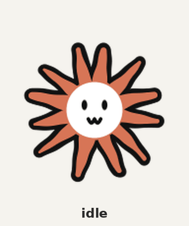

# Claude flower

The cartoon Claude — a wobbly terracotta flower with a sticker face — as an animated sprite, drawn entirely in procedural JavaScript. No image model, no npm dependencies: a small signed-distance-field rasterizer draws every frame from geometry and a face vocabulary.



## Credit

Character design by **Theia Vogel** ([thebes / @voooooogel](https://x.com/voooooogel)), who dedicated it to the public domain under CC0: https://x.com/voooooogel/status/2117746655969808812. The expressions follow her sticker set at https://vgel.me/misc/claude-stickers/. Thank you, Theia — this exists because you gave the flower away.

Drawn by Claude, with janbam.

## License

CC0 1.0 Universal, same spirit as the design: code and rendered output are public domain. Draw, remix, animate, ship it. See `LICENSE`.

## Build

```
python3 build.py            # render + package + previews into out/
python3 build.py --install  # also install as a Codex companion (~/.codex/pets/claude-flower/)
```

Needs `bun` and Pillow. `draw.js` writes the raw 1536x2288 atlas (8x11 cells of 192x208); `build.py` turns it into the Codex package and preview media.

## Layout

- `draw.js` — flower geometry, face vocabulary, per-state poses, rasterizer, PNG encoder.
- `build.py` — packaging, per-state GIFs, labeled showcase GIF.
- `out/codex/` — Codex v2 sprite package (`spritesheet.webp` + manifest; Codex requires the manifest name `pet.json`).
- `out/previews/*.gif`, `out/showcase.gif` — previews.

States: idle, walking right/left, waving, jumping, failed, waiting, working, review, plus 16 look directions. Row 0 col 6 holds the neutral look frame the Codex v2 format expects.
